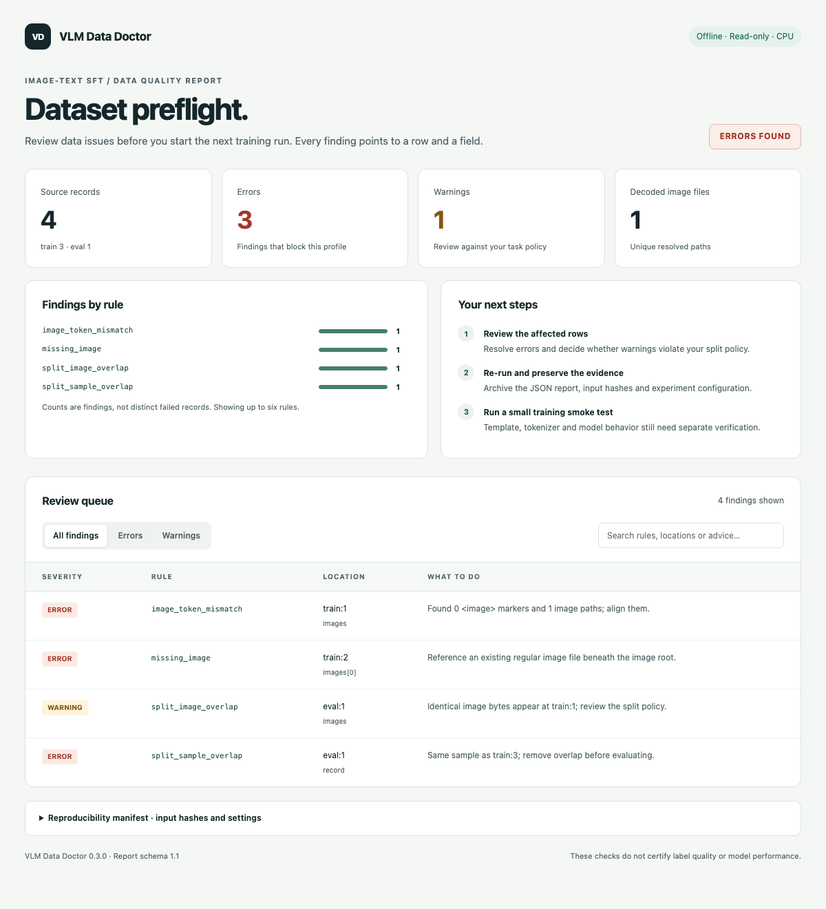
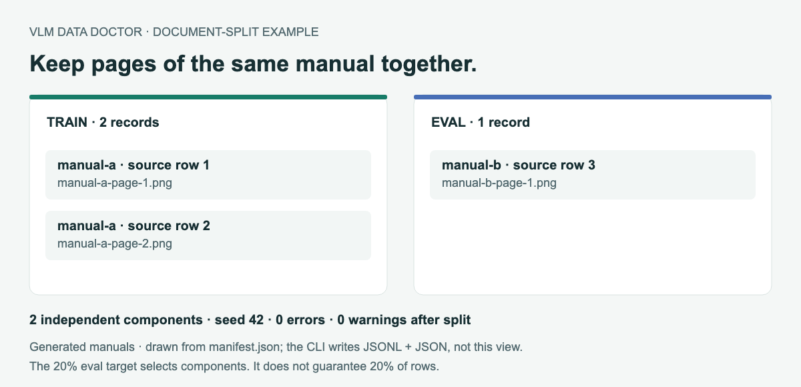

# VLM Data Doctor

训练前检查图文数据：找出坏记录，再把相关页面留在同一侧划分。

[](https://github.com/crown-sports/vlm-data-doctor/actions/workflows/ci.yml)
[Python 3.10+](pyproject.toml) · [v0.3.1 预览版](https://github.com/crown-sports/vlm-data-doctor/releases/tag/v0.3.1) · [MIT](LICENSE)

[English](README.md) · [试用](#先看一份报告) · [检查规则](docs/checks.md) · [LlamaFactory 接入](docs/integrations/llamafactory.md)

图片没拷全、`<image>` 数量不对，最好在提交训练任务前发现。Data Doctor 检查本地图文 SFT 数据，
在 HTML 报告中列出行号、字段和修复建议，也能检查训练集与评测集之间的精确重叠。



*仓库故障样例的实际输出：3 个错误、1 个警告。CPU 即可，不加载模型、不调用外部 API。*

## 先看一份报告

```bash
git clone --branch v0.3.1 https://github.com/crown-sports/vlm-data-doctor.git
cd vlm-data-doctor
python -m venv .venv
```

macOS/Linux 执行 `source .venv/bin/activate`；PowerShell 执行 `.venv\Scripts\Activate.ps1`，然后：

```bash
python -m pip install .
vlm-data-doctor check examples/broken/train.jsonl --eval examples/broken/validation.jsonl --image-root examples/clean --format html --output report.html
```

用浏览器打开 `report.html`。样例故意包含错误，命令生成报告后返回 `1`。再次运行时换一个输出文件名。

再试一下正常数据：

```bash
vlm-data-doctor check examples/clean/train.jsonl --eval examples/clean/validation.jsonl --strict
```

预期为 2 条训练记录、1 条评测记录，0 错误、0 警告。

## 同一份文档的页面，一起分

两张不同的图片也可能来自同一本手册。如果想评估模型对未见文档的表现，就需要把同一文档的页面放在同一侧。



*根据生成手册样例的实际 `manifest.json` 绘制；命令输出的是 JSONL 和 JSON 文件。*

```bash
vlm-data-doctor split examples/document-split/all.jsonl --group-key document_id --eval-fraction 0.2 --seed 42 --output manual-split
vlm-data-doctor check manual-split/train.jsonl --eval manual-split/eval.jsonl --image-root examples/document-split --group-key document_id --strict
```

得到 `train.jsonl`、`eval.jsonl` 和 `manifest.json`，可以查看原始行号、分配结果、哈希与复查结果。
目标目录必须不存在，缺失的父目录会自动创建。

文档 ID、相同图片字节或规范化输入相同的记录会连在一起，传递关联也会保留。
比例按这些关联组计算，**20% 不保证恰好分出 20% 的行**。图片不复制，后续仍使用原始图片根目录。
[完整示例](examples/document-split/README.zh-CN.md)。

## 换成自己的数据

支持 JSON 数组或 JSONL，使用 `messages` 或 ShareGPT `conversations`：

```json
{
  "document_id": "manual-a",
  "messages": [
    {"role": "user", "content": "<image>这个方块是什么颜色？"},
    {"role": "assistant", "content": "红色。"}
  ],
  "images": ["images/red.png"]
}
```

```bash
vlm-data-doctor check data/train.jsonl --eval data/test.jsonl --image-root data --group-key document_id --format json --output audit.json
```

替换为自己的路径。图片默认相对于数据文件目录，也可用 `--image-root` 指定根目录。
`document_id` 仅在选用 `--group-key` 时必填。退出码：`0` 无错误，`1` 有数据错误，`2` 参数或读写失败；
`--strict` 也会在有警告时失败。缺失的报告父目录会自动创建，已有报告不会被覆盖。

目前检查格式、图片解码和精确重叠，不判断答案质量，也不检测裁剪、重压缩后的近重复图片。

[报告路径与失败恢复](docs/checks.md#find-a-report-and-recover-from-a-failed-run) · [完整规则与 Python API](docs/checks.md) · [LlamaFactory 接入](docs/integrations/llamafactory.md) · [性能测试](docs/benchmarks.md) · [实现说明](docs/product.md) · [图片来源](docs/screenshots.md)

[贡献指南](CONTRIBUTING.md) · [版本记录](CHANGELOG.md) · [软件引用](CITATION.cff)
